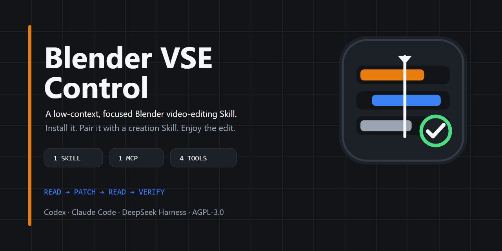

# Blender VSE Control

[Chinese documentation](README_zh-CN.md)



> Let AI agents edit in Blender while the timeline stays visible, editable,
> and under your control.

Blender VSE Control is a local, typed, revision-safe control layer for
Blender's Video Sequence Editor (VSE). Applications and agents can inspect,
edit, resume work on, and render named `.blend` timelines, then verify that
their changes persist. The file remains the source of truth, and human changes
remain protected.

> Status: alpha. Blender 5.1 is the primary verified target. The bundled bridge
> declares compatibility with Blender 4.2+, but official support claims cover
> only the versions listed in the release notes.

## Pairing with a director Skill

Blender VSE Control is the timeline execution layer, not the creative director.
For an automated workflow that runs from concept and storyboard through
source-media preparation and final assembly, pair it with an available director
or production-orchestration Skill:

- The director Skill owns the creative brief, narrative structure, shot plan,
  asset requirements, and acceptance criteria, then delegates concrete timeline
  edits.
- Blender VSE Control applies those edits to the named `.blend`, protects human
  revisions, renders when requested, and verifies that the saved timeline
  persists.

Media generation, sourcing, and licensing remain the responsibility of the
upper-layer workflow and its chosen tools. The resulting `.blend` stays
editable, so a human can intervene without giving up control.

## Install

Linux and macOS:

```bash
curl -LsSf https://raw.githubusercontent.com/Aoike123/blender-vse/main/install.sh | sh
```

Windows (PowerShell):

```powershell
powershell -ExecutionPolicy ByPass -c "irm https://raw.githubusercontent.com/Aoike123/blender-vse/main/install.ps1 | iex"
```

The script installs [uv](https://docs.astral.sh/uv/) when it is missing, then
installs the `blender-vse-mcp` command on uv's managed Python 3.12 and checks
for Blender. Register `blender-vse-mcp` as a stdio MCP server in your host the
same way as any other MCP server; nothing else needs configuring.

Projects always live in `blender-vse-projects/` inside the folder the host runs
in, and tools take paths relative to it, such as `demo.blend`. Moving or
renaming the workspace keeps everything working.

## Core guarantees

- **Observed writes:** every patch requires the revision, timeline hash, and
  single-use observation ID returned by a fresh read.
- **No silent overwrite:** patching a changed timeline fails with a
  `stale_base` error.
- **Atomic edits:** a command list commits one revision or rolls back.
- **Visible collaboration:** interactive edits require verified GUI visibility,
  project identity, and access to the VSE timeline and preview.
- **Persistence evidence:** final verification reopens the canonical `.blend`
  in a fresh Blender process and checks saved structural facts. It does not
  inspect frames or judge visual or creative correctness.
- **Bounded surface:** callers select operations from the catalog; they can
  never submit free-form Python.
- **Bounded context:** reads default to summaries; range/detail pages disclose
  only selected fields and carry revision-bound cursors; write, verify, and
  error receipts also have byte budgets.
- **Bounded resume:** compaction capsules keep durable intent and recent
  evidence within 4 KB, replacing older history with counts and digests.

## Develop from source

Source contributors use Python 3.10+:

```bash
python -m venv .venv
python -m pip install -e ".[dev]"
blender-vse status
```

To connect an Agent host from a checkout, install `.[mcp]` and register
`blender-vse-mcp`. See the [local MCP guide](docs/mcp.md).

The repository also includes a progressive-disclosure
[`blender-vse` Skill](skills/blender-vse/SKILL.md). It defines prompt-level
read, patch, and recovery discipline, while the MCP server handles execution.
The server also serves this Skill as its instructions, a `blender-vse` prompt,
and `blender-vse://skill/...` resources, so one-line installs get it too.
Neither layer stores the host's conversation history.

For local Codex installation, the repository is also a validated plugin root
that can build a deterministic local-marketplace archive. See the
[plugin guide](docs/plugin.md).

Create or read a project, then use the returned `revision`, `timeline_hash`,
and `observation_id` in a patch:

```bash
blender-vse read ./projects/demo.blend --create
blender-vse patch ./projects/demo.blend \
  --base-revision 0 \
  --base-timeline-hash HASH_FROM_READ \
  --read-token TOKEN_FROM_READ \
  --patch-id patch-title-001 \
  --commands '[{"op":"add_text","text":"Hello","channel":3,"frame_start":1,"length":90}]'
blender-vse verify ./projects/demo.blend
```

Read the project again before every subsequent patch. See the
[getting-started guide](docs/getting-started.md) for Python examples and setup
details.

For long-running Agent sessions, start with `summary` and request a targeted
`range/detail` read only when needed. Use `--view full` only for explicit
legacy debugging. See the [context model](docs/context-model.md).

## Test profiles

One manifest, [`tests/test-plan.json`](tests/test-plan.json), defines every
test profile, performance target, and hard timeout:

| Profile | Purpose | Command | Target / timeout |
| --- | --- | --- | ---: |
| `fast` | Core unit + contracts; no MCP/Blender process | `python tests/run.py fast` | 3 / 10 s |
| `coverage` | Host-side branch coverage | `python tests/run.py coverage` | 5 / 15 s |
| `mcp` | Four-tool contract + one real stdio discovery | `python tests/run.py mcp` | 4 / 10 s |
| `plugin` | Exact plugin-declared stdio launch | `python tests/run.py plugin` | 60 / 180 s |
| `harness` | Real Claude package validation | `python tests/run.py harness` | 60 / 180 s |
| `stateful` | Scenario replay + 250-cycle compaction eval | `python tests/run.py stateful` | 5 / 15 s |
| `blender-headless` | Native media decode | `python tests/run.py blender-headless` | 15 / 60 s |
| `blender-smoke` | One public multi-patch GUI workflow with read-after-write and persistence verification | `python tests/run.py blender-smoke` | 120 / 240 s |
| `blender-full` | Complete Blender regression suite | `python tests/run.py blender-full` | 900 / 1200 s |

Run `python tests/run.py list` to inspect the plan. Detailed safety and CI rules
are documented in [Testing](docs/testing.md).

## Documentation

- [Documentation index](docs/index.md)
- [Getting started](docs/getting-started.md)
- [Python and CLI API](docs/api.md)
- [Operation catalog](docs/operations.md)
- [Architecture](docs/architecture.md)
- [Configuration](docs/configuration.md)
- [Context model](docs/context-model.md)
- [Local MCP server](docs/mcp.md)
- [Agent Skill](skills/blender-vse/SKILL.md)
- [Local Codex plugin](docs/plugin.md)
- [Installation](docs/installation.md)
- [Testing](docs/testing.md)
- [Security policy](SECURITY.md)
- [Contributing](CONTRIBUTING.md)
- [Release checklist](RELEASING.md)

## Project boundary

This repository is responsible for Blender execution, allowlisted timeline
operations, revision safety, and persistence verification. It validates
externally generated
[proxy manifests](src/blender_vse/schemas/proxy-manifest.schema.json) before
attaching them. It does not generate or source media, download or transcode
media, encode or rebuild proxies, automate general Blender 3D workflows or
arbitrary `bpy` operations, maintain a project-wide asset database, or provide
an agent framework. Attaching a proxy preserves the original source path, and
final rendering still uses the source media.

## License

Blender VSE Control is released under the [MIT License](LICENSE). The vendored
Blender MCP Bridge remains under its own MIT license; see
[Third-party notices](THIRD_PARTY_NOTICES.md).
