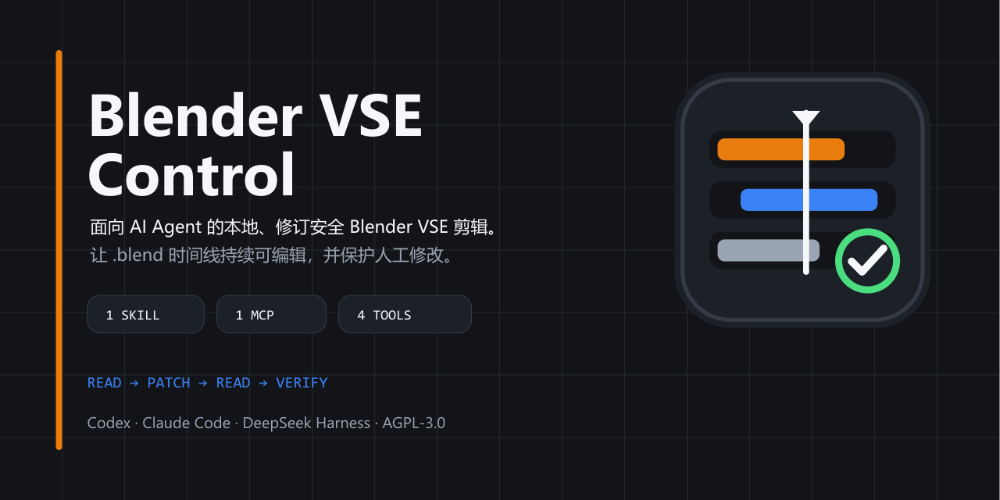

# Blender VSE Control

[English documentation](README.md)



> 让 AI Agent 在 Blender 中完成剪辑，同时让时间线始终可见、可编辑，并由你掌控。

Blender VSE Control 是面向 Blender 视频序列编辑器（Video Sequence Editor，VSE）的本地控制层，具备明确的类型约束和修订保护机制。应用和 Agent 可以检查、编辑、继续处理和渲染指定的 `.blend` 时间线，再验证修改是否已持久化。`.blend` 文件始终是事实源，人工修改不会被静默覆盖。

> 状态：Alpha。Blender 5.1 是当前主要验证目标。随附的 Bridge 声明兼容 Blender 4.2+，但官方只对发布说明中列出的版本作出支持承诺。

## 与导演 Skill 搭配

Blender VSE Control 是时间线执行层，不承担创意导演的职责。如果希望 Agent 从创意、分镜、
素材准备一路自动推进到最终组装，建议与可用的导演或制作编排 Skill 搭配使用：

- 导演 Skill 负责创意简报、叙事结构、镜头方案、素材需求和验收标准，再把明确的时间线修改
  交给本项目执行。
- Blender VSE Control 负责把这些修改写入指定的 `.blend`，保护人工修订，按需渲染，并验证
  保存后的时间线确实已经持久化。

素材生成、获取和授权仍由上层流程及其所选工具负责。最终 `.blend` 始终可编辑，人工可以
随时介入，而不会失去对时间线的控制。

## 安装

Linux 与 macOS：

```bash
curl -LsSf https://raw.githubusercontent.com/Aoike123/blender-vse/main/install.sh | sh
```

Windows（PowerShell）：

```powershell
powershell -ExecutionPolicy ByPass -c "irm https://raw.githubusercontent.com/Aoike123/blender-vse/main/install.ps1 | iex"
```

脚本会在缺少 [uv](https://docs.astral.sh/uv/) 时先安装它，再用 uv 托管的 Python 3.12 安装
`blender-vse-mcp` 命令，并检查 Blender 是否可用。之后像添加其他 MCP 服务器一样，在宿主中把
`blender-vse-mcp` 注册为 stdio MCP 服务器即可，无需其他配置。

工程始终保存在宿主所在工作文件夹下的 `blender-vse-projects/` 中，工具使用相对于它的路径，
例如 `demo.blend`。工作文件夹移动或改名后依然可用。

## 核心保证

- **基于观察写入：** 每次 `patch` 都必须使用最新 `read` 返回的修订号、时间线哈希和单次使用的观察 ID。
- **不静默覆盖：** 对已经变更的时间线执行 `patch` 会因 `stale_base` 错误而失败。
- **原子编辑：** 一组命令要么以一次修订完整提交，要么整体回滚。
- **可见协作：** 交互式编辑必须经过验证，确认 Blender GUI 可见、项目身份匹配，并且 VSE 时间线和预览可用。
- **持久化证据：** 最终验证会在新的 Blender 进程中重新打开作为事实源的 `.blend` 文件，检查已保存的结构事实；不会检查画面，也不会判断视觉质量或创意是否正确。
- **操作范围受限：** 调用方只能选择操作目录中登记的操作，不能提交任意 Python 代码。
- **有界上下文：** 读取默认返回摘要；`range` / `detail` 页面只公开选定字段，并携带与修订绑定的游标；写入、验证和错误回执同样受字节预算限制。
- **有界恢复：** 压缩胶囊会在 4 KB 内保存持久意图和近期证据，以计数和摘要替代更早的历史记录。

## 从源码开发

源代码贡献者使用 Python 3.10+：

```bash
python -m venv .venv
python -m pip install -e ".[dev]"
blender-vse status
```

若要从源码连接 Agent 宿主，请安装 `.[mcp]` 并注册 `blender-vse-mcp`。参见[本地 MCP 指南](docs/mcp_zh-CN.md)。

仓库还附带采用渐进式披露的 [`blender-vse` Skill](skills/blender-vse/SKILL_zh-CN.md)。它规定提示层面的 `read`、`patch` 和恢复规范，MCP 服务负责具体执行。这两层都不会存储宿主的对话历史。

对于本地 Codex 安装，仓库根目录也是经过验证的插件根目录，能够构建确定性本地市场归档。参见[插件指南](docs/plugin_zh-CN.md)。

创建或读取一个项目，然后在 `patch` 中使用返回的 `revision`、`timeline_hash` 和 `observation_id`（观察 ID）：

```bash
blender-vse read ./projects/demo.blend --create
blender-vse patch ./projects/demo.blend \
  --base-revision 0 \
  --base-timeline-hash HASH_FROM_READ \
  --read-token TOKEN_FROM_READ \
  --patch-id patch-title-001 \
  --commands '[{"op":"add_text","text":"你好","channel":3,"frame_start":1,"length":90}]'
blender-vse verify ./projects/demo.blend
```

之后每次执行 `patch` 前，都要重新读取项目。完整安装步骤和 Python 示例参见[入门指南](docs/getting-started_zh-CN.md)。

长时间运行的 Agent 会话应从 `summary` 开始，仅在需要时请求定向的 `range/detail` 读取。`--view full` 仅用于明确的旧版兼容调试。具体规则见[上下文模型](docs/context-model_zh-CN.md)。

## 测试分层

所有测试档位、性能目标和硬超时均统一定义在 [`tests/test-plan.json`](tests/test-plan.json)：

| 档位 | 用途 | 命令 | 目标 / 硬超时 |
| --- | --- | --- | ---: |
| `fast` | 核心单元测试和契约测试；不启动 MCP 或 Blender 进程 | `python tests/run.py fast` | 3 / 10 秒 |
| `coverage` | 宿主端 Python 分支覆盖率 | `python tests/run.py coverage` | 5 / 15 秒 |
| `mcp` | 四个工具的契约测试，以及一次真实的 stdio 发现 | `python tests/run.py mcp` | 4 / 10 秒 |
| `plugin` | 严格按照插件声明启动 stdio | `python tests/run.py plugin` | 60 / 180 秒 |
| `harness` | 真实 Claude 打包验证 | `python tests/run.py harness` | 60 / 180 秒 |
| `stateful` | 场景重放和 250 轮压缩评估 | `python tests/run.py stateful` | 5 / 15 秒 |
| `blender-headless` | Blender 原生媒体解码 | `python tests/run.py blender-headless` | 15 / 60 秒 |
| `blender-smoke` | 一次公开的多 Patch GUI 流程，包含写后读取与持久化验证 | `python tests/run.py blender-smoke` | 120 / 240 秒 |
| `blender-full` | 完整的 Blender 回归测试套件 | `python tests/run.py blender-full` | 900 / 1200 秒 |

运行 `python tests/run.py list` 可查看完整计划。详细的测试安全规则和 CI 分工参见[测试指南](docs/testing_zh-CN.md)。

## 文档

- [中文文档索引](docs/index_zh-CN.md)
- [英文文档索引](docs/index.md)
- [入门指南](docs/getting-started_zh-CN.md)
- [Python 与 CLI API](docs/api_zh-CN.md)
- [操作目录](docs/operations_zh-CN.md)
- [架构](docs/architecture_zh-CN.md)
- [配置](docs/configuration_zh-CN.md)
- [上下文模型](docs/context-model_zh-CN.md)
- [本地 MCP 服务](docs/mcp_zh-CN.md)
- [Agent Skill](skills/blender-vse/SKILL_zh-CN.md)
- [本地 Codex 插件](docs/plugin_zh-CN.md)
- [安装](docs/installation_zh-CN.md)
- [测试指南](docs/testing_zh-CN.md)
- [安全策略](SECURITY_zh-CN.md)
- [贡献指南](CONTRIBUTING_zh-CN.md)
- [发布清单](RELEASING_zh-CN.md)

## 项目边界

本仓库负责 Blender 执行、列入允许列表的时间线操作、修订保护和持久化验证。[外部生成的代理清单](src/blender_vse/schemas/proxy-manifest.schema.json)只有通过验证后才会附加。本项目不生成或获取媒体素材，不下载或转码媒体，不编码或重建代理，不负责通用 Blender 3D 工作流或任意 `bpy` 操作的自动化，不维护项目级资产数据库，也不提供 Agent 框架。附加代理时会保留原始素材路径，最终渲染仍使用源素材。

## 许可证

Blender VSE Control 依据 [MIT 许可证](LICENSE) 发布。随附的 Blender MCP Bridge 继续采用 MIT 许可证，详见[第三方声明](THIRD_PARTY_NOTICES_zh-CN.md)。
